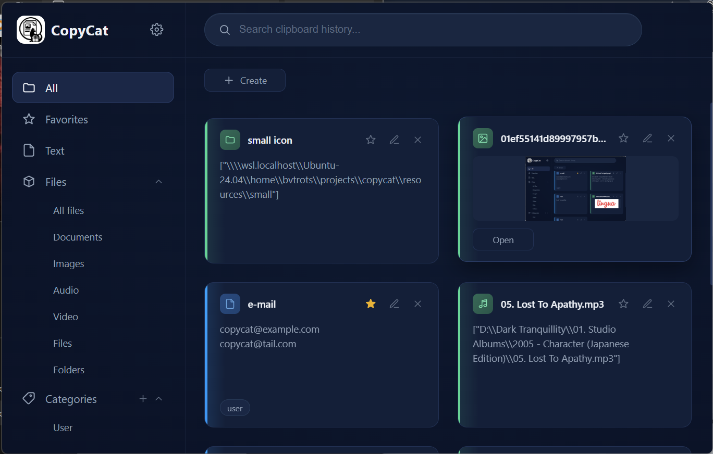

# Copycat

Copycat is a clipboard history manager for Windows. Built on Electron, React, and SQLite.

[](https://github.com/murpiano/copycat/actions/workflows/ci.yml)
[](https://github.com/murpiano/copycat/releases/latest)

[How it works](#how-it-works) · [Run locally](#run-locally) · [Where things live](#where-things-live) · [API](#api) · [Rough edges](#rough-edges)

First run creates its own SQLite database and settings under the Electron user-data folder; nothing leaves the machine except the GitHub release feed used for auto-updates.

## What you can do

Copycat sits in the system tray and keeps a running history of everything you copy — text, images, and file or folder references — reachable from anywhere with a global hotkey (`Ctrl+F1` by default, rebindable). Cards can be starred, filed into categories, dragged into a custom order, searched, renamed, and reopened or re-copied straight from the grid. Text entries are capped at 200,000 characters; history keeps the most recent 1,000 non-starred cards and prunes older ones automatically, while starred cards are never pruned. File and folder cards keep tracking their target: moving one into a folder Copycat already watches relinks it automatically, and a manual "locate" picker covers everything else.

## How it works

### Capture pipeline

Every clipboard change is picked up once in `src/main/clipboard` (`watcher.ts` polls the system clipboard, `capture-pipeline.ts` classifies the snapshot as text, file paths, or an image), written to SQLite through `src/main/storage/items-repo.ts`, and the history is pruned back to the retention limit.

### Storage

A `better-sqlite3` database lives under the app's user-data folder. Clipboard images that have no file of their own (screenshots, pasted bitmaps) are saved once as PNGs under `previews/`; a downscaled 480px thumbnail is generated alongside for the grid, while the first full-resolution copy stays untouched for paste, copy, and the expanded view.

### File link tracking

`src/main/files/location-tracker.ts` watches the folders that currently hold a file or folder card (plain `fs.watch`, no extra dependency) plus a 60-second safety sweep. A file moved into a folder Copycat is already watching gets relinked automatically by matching name and kind; anything moved elsewhere is flagged "not found" with a manual relink action.

### Renderer

The React UI talks to the main process only through the `contextBridge` surface in `src/preload`, exposed as `window.copycat`, backed by a Zustand store (`src/renderer/store/useClipboardStore.ts`). The card grid is row-virtualized, so a long history doesn't mount every card at once.

## Run locally

```bash
git clone https://github.com/murpiano/copycat.git
cd copycat
npm install

npm run dev       # electron-vite dev server with hot reload
npm test          # jest unit tests (main process + renderer)
npm run typecheck # tsc --noEmit
npm run build     # electron-vite production build
```

Needs Node 22 — `better-sqlite3` ships a prebuilt binary for that ABI, so `npm install` needs no C++ toolchain. Running the packaged app, or `npm run dist` (NSIS installer via electron-builder), needs Windows.

Unit tests under `tests/unit` cover storage, IPC handlers, and renderer components; `tests/e2e` drives the built renderer with Playwright (`npm run test:e2e`). `.github/workflows/ci.yml` runs `typecheck` and the unit suite on every push and pull request to `master`. A successful CI run there triggers `.github/workflows/release.yml`, which reads Conventional Commit messages since the last tag to cut a GitHub release and publish the Windows installer that `electron-updater` picks up.

## Where things live

```text
src/
├── main/        Electron main process: clipboard capture, SQLite storage,
│                file-link tracking, IPC handlers, tray, hotkey, auto-update
├── preload/     contextBridge surface exposed to the renderer as window.copycat
├── renderer/    React UI — components, the Zustand store, i18n
└── shared/      Types, IPC channel names, and config used by both processes
```

Tests mirror this layout under `tests/unit/{main,clipboard,ipc,storage,renderer,shared}`; `tests/e2e` holds the Playwright suite.

## API

Copycat has no network API. The renderer reaches the main process only through the `contextBridge` surface (`window.copycat`, defined in `src/preload/index.ts`), over the channels declared in `src/shared/ipc-channels.ts`.

| Channel | Direction | Purpose |
| --- | --- | --- |
| `get-items` | renderer → main | Fetch the card list for the current view or search |
| `create-item` | renderer → main | Add a manually typed or picked card |
| `open-item` / `copy-item` / `paste-item` | renderer → main | Open a card's source, or put it back on the system clipboard |
| `relink-item` | renderer → main | Point a "not found" card at a new path |
| `item-added` / `items-changed` | main → renderer | Push a new capture, or a background change such as an auto-relink |

## Rough edges

- History keeps at most 1,000 non-starred cards; starred cards are never pruned, so starring many screenshots grows `previews/` without a cap.
- Automatic file/folder relinking only works when the new location is a folder Copycat is already watching (i.e. it holds another tracked card); a move anywhere else needs the manual "locate" action.
- Packaged distribution targets Windows only (NSIS); copying file paths back onto the system clipboard shells out to PowerShell there.
- Drag-to-reorder disables grid virtualization for that view, so a very large starred or category list renders in full while reordering.

---

<sub>[Bogdan Trotsenko](https://github.com/murpiano) · [murpiano](https://github.com/murpiano) · [Telegram](https://t.me/murpiano) · [MIT](LICENSE)</sub>
